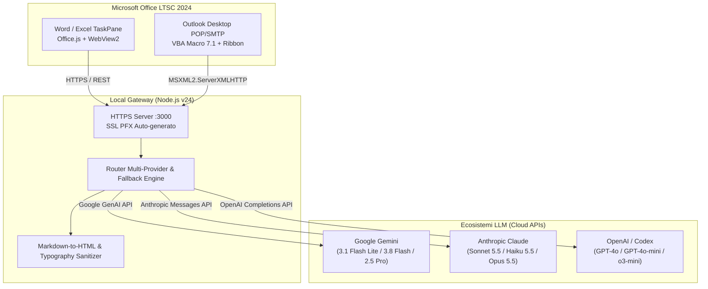

> **Documento storico.** Descrive il prototipo iniziale (novembre 2026) con server Node locale, poi sostituito: vedi il README e il CHANGELOG. Il progetto ora si chiama **Personal AI Assistant** e non usa più il server: il pannello e la macro chiamano direttamente i provider. Vedi [README.md](README.md). Le affermazioni qui sotto non sono state riverificate.

# Relazione di Progetto: Office AI Copilot (Multi-Modello)

**Data:** 18 Novembre 2026  
**Ambiente Operativo:** Microsoft Office LTSC Professional Plus 2024 (Windows x64 / Office x86)  
**Workspace:** `<cartella del progetto>`

---

## 1. Fine Ultimo (Visione & Obiettivi)

Il progetto nasce con l'obiettivo di realizzare un assistente di Intelligenza Artificiale Generativa **integrato nativamente e direttamente nei flussi di lavoro di Microsoft Office 2024 (Word, Excel e Outlook)**, eliminando l'attrito del continuo copia-incolla verso interfacce web esterne.

### Obiettivi Strategici Raggiunti:
1. **Indipendenza da licenze costose:** Superamento dell'abbonamento proprietario Microsoft Copilot (~30 €/mese per utente) tramite un'architettura **BYOK (Bring Your Own Key)** che sfrutta i piani gratuiti ad alto volume (Google AI Studio) o modelli pay-per-token ad altissima convenienza (frazioni di centesimo per documento).
2. **Flessibilità Multi-Modello Agnostica:** Possibilità di switchare al volo dall'interfaccia utente tra i tre principali ecosistemi di frontiera: **Google Gemini**, **Anthropic Claude** e **OpenAI (Codex / GPT-4o)** in base al task (velocità, creatività stilistica o rigore logico).
3. **Piena compatibilità con vincoli aziendali:** Funzionamento impeccabile su edizioni **Office LTSC 2024** e su caselle di posta configurate con protocollo tradizionale **POP/SMTP**, notoriamente escluse dal supporto nativo dei componenti aggiuntivi web di Microsoft.
4. **Preservazione Tipografica e User Experience "Viva":** Mantenimento rigoroso del layout del documento (font, corpi, colori) unito a un effetto visivo di digitazione progressiva in tempo reale (*typewriter effect*), sia nel pannello che direttamente sul foglio di Word.

---

## 2. Architettura & Tecnologie Utilizzate

L'architettura è modulare e ibrida, progettata per garantire massime prestazioni, sicurezza locale e zero dipendenze esterne pesanti.

### Componenti Tecnologici di Dettaglio:

| Componente | Tecnologia | Scopo e Ruolo nell'Architettura |
| :--- | :--- | :--- |
| **Pannello Word ed Excel** | `Office.js` (v1.1), HTML5, CSS3 Fluent UI, JavaScript moderno | Interfaccia utente nativa nel *Task Pane* laterale, responsive, con riconoscimento automatico dell'applicazione ospitante. |
| **Motore di Rendering** | Microsoft Edge WebView2 (Chromium) | Esecuzione sicura del codice web all'interno delle finestre di Office LTSC 2024 su Windows. |
| **Backend & Proxy Locale** | Node.js v24 (Zero external dependencies) | Gestione del traffico HTTPS locale con certificati PFX, lettura dinamica di `.env`, sicurezza delle API key e router unificato. |
| **Sanitizzazione & Formatting** | Regex engine & AST cleaning personalizzato | Pulizia istantanea di prefissi, rimozione di asterischi markdown residui e conversione dinamica Markdown $\rightarrow$ HTML per Outlook. |
| **Automazione Outlook POP3** | VBA (Visual Basic for Applications 7.1) | Superamento delle limitazioni POP/SMTP tramite interazione diretta con l'`Outlook.Explorer` e invio di richieste HTTP a `localhost:3000`. |
| **Configurazione di Sistema** | Windows Registry (`HKCU`), PowerShell | Sideloading degli add-in senza privilegi di amministratore tramite le chiavi `WEF\Developer` e `TrustedCatalogs`. |

---

## 3. Risultato Conseguito & Funzionalità Operative

### 📄 Microsoft Word
* **Rielaborazione in-place:** Selezionando un testo, è possibile riscriverlo modificandone il tono (Formale, Diretto, Commerciale, Accademico), correggerne bozze e sintassi o tradurlo in inglese.
* **Preservazione Tipografica Perfetta:** Prima della sostituzione, il plugin memorizza font (es. *Aptos, Calibri*), dimensione, colore e stile di paragrafo, riapplicandoli esattamente sul testo riscritto.
* **Typewriter Effect Spettacolare:** Il risultato scorre con effetto digitazione e cursore lampeggiante `▍` sia nell'anteprima laterale, sia direttamente all'interno della pagina Word.
* **Q&A sul Documento:** Capacità di inviare centinaia di pagine di testo in un unico prompt a Gemini (sfruttando la context window fino a 1M token) per porre domande sull'intero file.

### 📊 Microsoft Excel
* **Formula Generator:** Traduzione istantanea di richieste in linguaggio naturale in formule avanzate (`XLOOKUP`, `INDEX/MATCH`, `SUMIFS`, `LAMBDA`), con inserimento automatico nella cella attiva con un clic.
* **Analisi Dati dell'Intervallo:** Lettura dinamica delle celle selezionate (`A1:D50`) e generazione di sintesi numeriche, anomalie e trend.
* **Generatore di Tabelle di Prova:** Creazione rapida di dataset realistici tabulari iniettati direttamente nel foglio.

### ✉️ Microsoft Outlook (POP/SMTP)
* **Integrazione Nativa su Account Legacy:** Integrazione riuscita al 100% su caselle `POP/SMTP` tramite pulsanti dedicati nella Ribbon principale (*Nuova scheda / Home*).
* **Risposte Rapide One-Click:** Risposte contestualizzate intelligenti (*Conferma & Ringrazia*, *Declina Gentilmente*, *Risposta su misura*) che aprono una nuova bozza con la risposta già scritta e firmata.
* **Formattazione Standard Nativa:** Eliminazione di qualsiasi carattere markdown grezzo (`**`, backtick, `??`), convertito in vero grassetto HTML (`<b>`), elenchi con punti elenco (`•`) e tipografia predefinita di Outlook (**Aptos 11pt nero**).
* **Sintesi Multi-Email (Funzionalità Chiave):** Selezionando più email contemporaneamente con `Ctrl` o `Shift`, la macro aggrega mittenti, orari e contenuti, generando un'email di riepilogo esecutivo strutturata con:
  * Tema generale della discussione
  * Cronologia dettagliata degli interventi
  * Decisioni prese, azioni da compiere e scadenze.

---

## 4. Riepilogo File del Progetto

* **[`server.js`]:** Gateway HTTPS locale multi-modello (Gemini, Claude, OpenAI).
* **[`avvia_server.bat`]:** Script di avvio rapido con un clic.
* **[`.env`]:** Gestore sicuro delle chiavi API.
* **[`public/taskpane.js`]:** Controller del pannello laterale con live typewriter e controllo tipografico Word/Excel.
* **[`public/index.html`] & [`public/style.css`]:** Interfaccia utente moderna Fluent UI.
* **[`manifest-word-excel.xml`]:** Descrittore per l'installazione in Word ed Excel.
* **[`outlook_macro.vba`]:** Codice VBA completo per l'integrazione in Outlook POP/SMTP con supporto multi-email.
